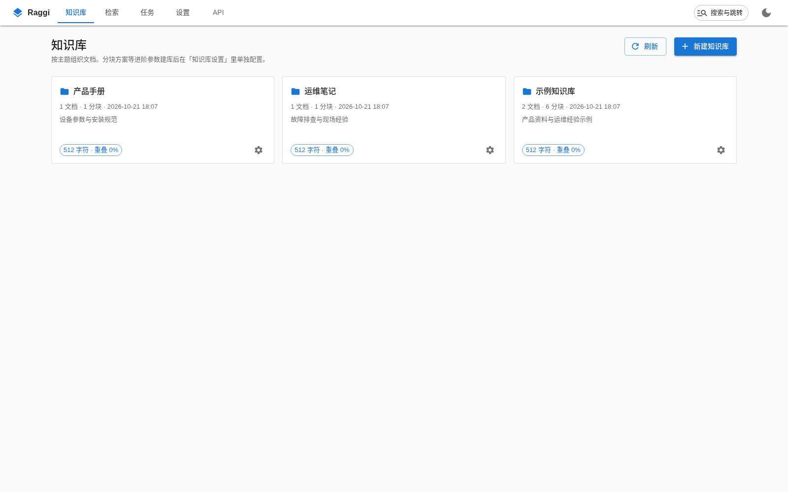
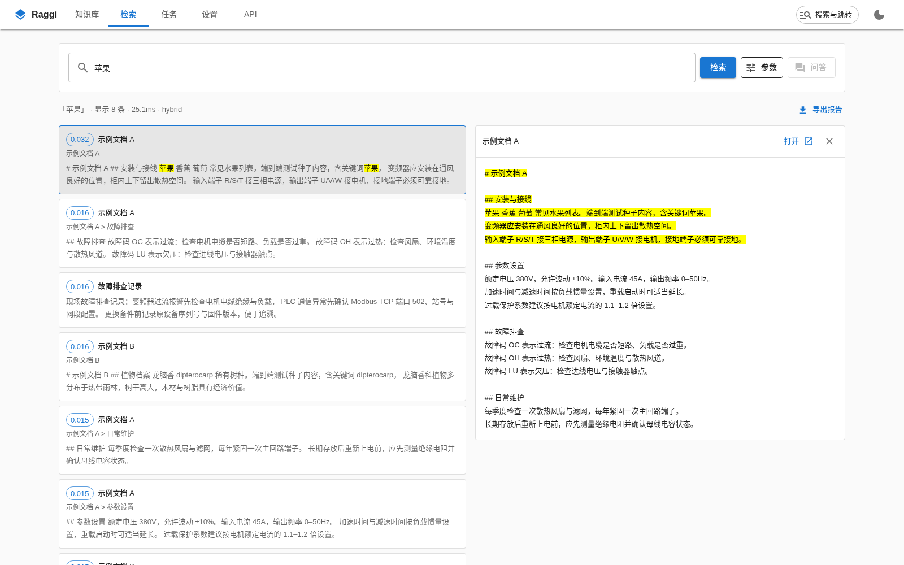
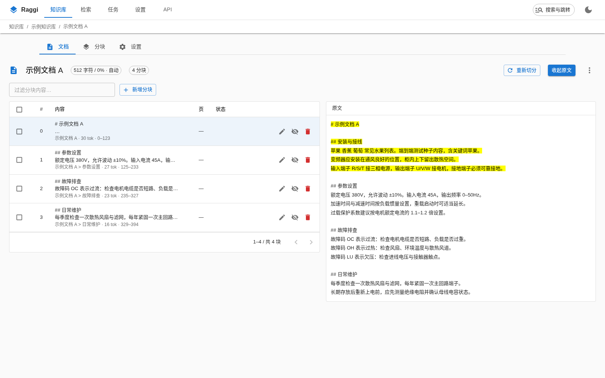
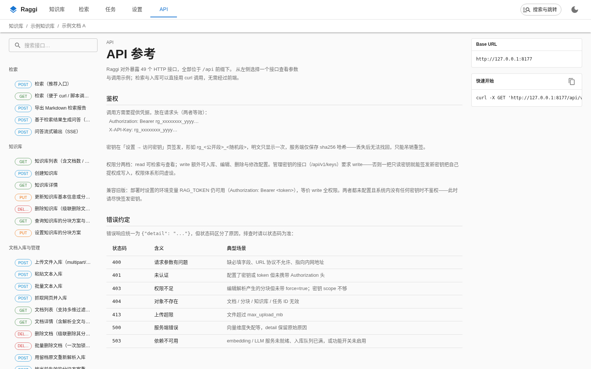
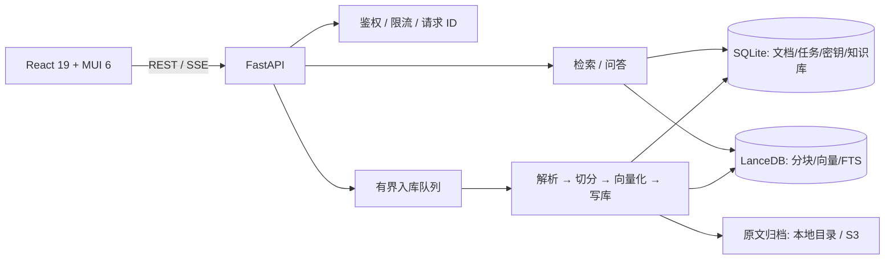

# Raggi

**本地部署的检索增强系统：多引擎解析入库、混合检索、分块编辑与内容查看。**

Raggi 把「文档进来 → 切分/向量化 → 混合检索 → 原文定位 → 分块维护」做成一个
可整体拷贝的单机应用：一条命令、一个端口、一个 `data/` 目录，不依赖 Docker、
外部向量数据库或消息队列。



## 特性

- **混合检索**：LanceDB 原生向量 + 全文（FTS）一次查询，RRF 融合，可选 HTTP /
  CrossEncoder 精排；支持过滤、分页、阈值、按文档合并与上下文窗口。
- **多引擎入库**：PyMuPDF4LLM / Docling / Unstructured / native 自动路由与失败回退；
  文件、粘贴文本、网页抓取三种入口，均走有界入库队列，可查看阶段、取消任务。
- **分块可维护**：查看/编辑/停用/删除分块，批量启停，手工新增；编辑后自动重新向量化。
  两级分块方案（知识库 → 文档），已入库文档可重新切分。
- **原文对照**：PDF 使用浏览器内置查看器按页定位，文本类文档按字符偏移高亮；
  原文默认折叠，深链 `?chunk=` 自动展开。
- **可控的模型配置**：Embedding / LLM / Rerank 支持 OpenAI 兼容、Ollama、
  HuggingFace 等 provider；保存即热切换、落盘，支持逐项连通性测试。
- **API 文档内置**：49 个接口的手写文档与 curl 示例，过滤/选中状态同步进 URL。
- **单机安全**：可吊销的读写 API 密钥、HMAC 签名原文链接、CSP、SSRF 防护、
  请求体上限、写操作限流；跨进程共享限流/幂等/缓存代际。
- **工程基线**：React 19 + MUI 6 前端、FastAPI + SQLite(WAL) 元数据 +
  LanceDB 向量/全文；ruff / mypy / tsc / pytest / Playwright 门禁。

## 界面

### 检索与原文检视



### 文档工作台

分块表与按需展开的原文对照；支持 `?src=1`、`?chunk=` 深链、行内编辑、
启停、批量操作与重新切分。



### API 文档



## 架构



- **SQLite(WAL)** 承载 OLTP 元数据（documents / jobs / kbs / apikeys / 幂等 / 限流 / 代际），
  点查与分页比列存引擎低两三个数量级。
- **LanceDB** 承载分块、向量与原生 FTS；写入由跨进程文件锁串行化，
  读可由多个 API worker 并行。
- **入库队列**默认 2 个 worker、容量 32；满时返回 503 背压，而不是无限堆积。
- **前端**是纯静态产物（Vite → `web/dist`），由 FastAPI 托管；运行时无 Node 依赖。

## 快速开始

### 1. 安装

需要 Python 3.10+、Node.js 20+。

```bash
git clone git@github.com:Ailoc/raggi.git
cd raggi

python3 -m venv .venv
source .venv/bin/activate
pip install -e .                 # 核心依赖
# 可选：pip install -e ".[docling,unstructured,local-models]"

npm install --include=dev
npm run build                    # 产物在 web/dist，运行时不需要 Node
```

### 2. 配置模型

首次启动后可在 **设置 → 模型** 里配置，也可以直接编辑 `data/config.toml`。
例如本地 Ollama：

```toml
[embed]
provider = "ollama"
model = "bge-m3"
base_url = "http://127.0.0.1:11434"
dim = 1024

[llm]
provider = "ollama"
model = "qwen2.5-7b-instruct"
base_url = "http://127.0.0.1:11434"

[features]
answer = true                    # 需要生成式问答时开启
```

> 向量维度必须与模型实际输出一致；变更维度会使已有数据的写入失效。

### 3. 启动

```bash
./start.sh                       # 默认 http://127.0.0.1:8156
# 或
rag serve --host 127.0.0.1 --port 8156 --data ./data
```

- Web 界面：<http://127.0.0.1:8156>
- 内置 API 文档：<http://127.0.0.1:8156/#/apidoc>
- OpenAPI / Swagger：<http://127.0.0.1:8156/docs>

进程管理：

```bash
./restart.sh          # 原地重启
./stop.sh             # 停止
RAGGI_PROCESSES=auto ./start.sh   # 多 API 进程（本机默认 1）
```

## 配置

配置来源优先级：**环境变量 > `data/config.toml` > 代码默认值**。
设置页保存会写回 `data/config.toml`（权限 0600）。

常用环境变量：

| 变量 | 说明 | 默认 |
|---|---|---|
| `RAG_DATA_DIR` | 数据目录 | `./data` |
| `RAG_HOST` / `RAG_PORT` | 监听地址 / 端口 | `127.0.0.1` / `8000`（脚本默认 `8156`） |
| `RAG_TOKEN` | 旧版静态 Bearer token | 空 |
| `RAG_STORAGE__BACKEND` | `local` 或 `s3` | `local` |
| `RAG_EMBED__PROVIDER` 等 | 模型配置（嵌套用 `__`） | 见 `data/config.toml` |
| `RAG_RATE_LIMIT_WRITES_PER_MIN` | 写操作每分钟限额，0 = 关闭 | `0` |

本机使用请绑定 `127.0.0.1`。若监听 `0.0.0.0` 且未配置任何密钥，启动日志会给出
明确的安全警告。

## 项目结构

```text
rag/
  api/            FastAPI 路由、鉴权、请求中间件
  core/           配置、缓存、限流、幂等、签名 URL
  ingest/         入库流水线、有界队列
  parsing/        解析器路由、加载与归一化
  retrieval/      混合检索、精排、问答
  storage/        LanceDB / SQLite / 仓储层 / 迁移 / 健康检查
web/src/          React 19 + MUI 6 前端
  views/          9 个路由级视图
  lib/            路由、API 客户端、状态、SSE、格式化
  ui/             对话框、命令面板、密钥/存储面板等
docs/             DESIGN、审计、性能与 UI 重构记录
tests/            后端行为测试 + 前端结构守卫
e2e/              Playwright 浏览器 E2E
tools/            bench 与 E2E 临时服务
```

## 测试

```bash
python3 -m pytest -q       # 后端 + 前端契约（625 passed）
npm run check              # tsc --noEmit
npm run build              # Vite 构建
npm run test:e2e           # Playwright（需要系统 Chrome）
```

浏览器 E2E 会启动一个临时数据目录 + 桩 embedding 的独立实例，覆盖首页 → 文档、
检索参数草稿、`?chunk=` 深链、API 文档、主题持久化与 CSP nonce 样式。

## 文档

- [架构与设计](docs/DESIGN.md) — 需求边界、选型、存储/检索/接口/前端设计
- [全栈审计（2026-10-20）](docs/AUDIT-2026-10-20.md) — 安全、一致性、性能、
  产品逻辑问题与修复证据
- [UI 重构与 React/MUI 迁移](docs/UI-REWRITE-PLAN-2026-10-04.md) — 分期记录与决策
- [并发性能审计](docs/PERF-FINAL-DECISION-2026-10-05.md) — 多进程、SQLite、索引与延迟结论
- [早期架构审计](docs/ARCH-AUDIT-2026-10-06.md)

## 边界

- 单租户、无用户体系；对外部署请使用 API 密钥并限制网络入口。
- 多进程写依赖同机文件锁；使用 S3 时请保持单一写入者。
- 生成式问答默认关闭，需要模型服务并设置 `features.answer=true`。
- 不包含 Agent / 工作流 / 多模态检索 / 分布式队列。

## 致谢

基于 [FastAPI](https://fastapi.tiangolo.com/)、[LanceDB](https://lancedb.com/)、
[LangChain](https://www.langchain.com/)、[React](https://react.dev/) 与
[MUI](https://mui.com/) 构建。
